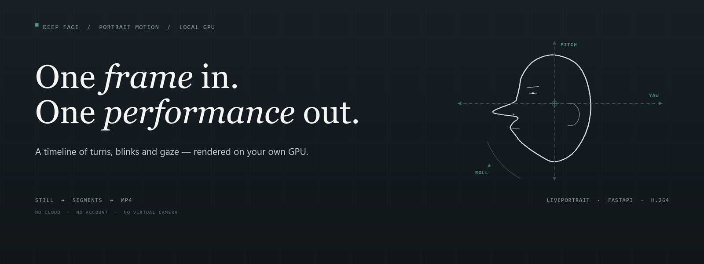
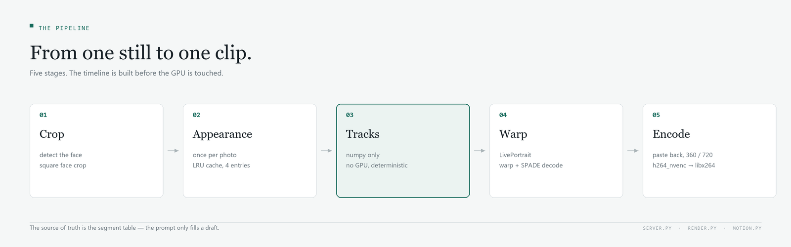
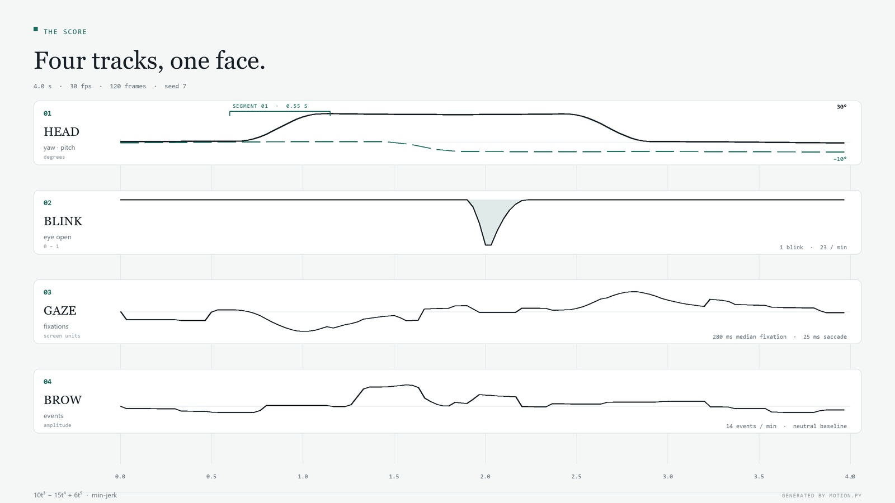

<p align="center">
  
</p>

<h1 align="center">DEEP FACE</h1>

<p align="center">
  <strong>One still portrait, one explicit timeline, one MP4.</strong><br />
  Head turns, blinks, gaze and brows — rendered locally on your own GPU.<br />
  <em>Портрет, который двигается по таймлайну.</em>
</p>

<p align="center">
  <a href="https://github.com/god4claw/deep-face-portrait-segmentation/actions/workflows/ci.yml"></a>
  
  
  
  
  
</p>

<p align="center">
  <a href="#how-it-works">How it works</a> ·
  <a href="#the-timeline">Timeline</a> ·
  <a href="#web-ui">Web UI</a> ·
  <a href="#performance">Performance</a> ·
  <a href="#motion-model">Motion model</a> ·
  <a href="#install">Install</a> ·
  <a href="#русский">Русский</a>
</p>

---

DEEP FACE animates one still portrait from an explicit table of movements. Each
row is an axis, a start angle, an end angle, a start time and a duration; the
renderer turns those numbers into a short MP4. The timeline is the source of
truth. A local language model can fill it with a draft, but it never becomes the
interface.

Everything runs on localhost against a LivePortrait checkout you already have.
No account, no third-party upload, no virtual camera.

> **Scope.** This is a tool for animating a portrait you own. It does not
> implement virtual-camera replacement, identity swaps, or liveness/KYC bypasses.

## Features

- **Timeline first** — every movement is a validated row, editable by hand
- **Deterministic tracks** — the same seed and segments produce the same frames
- **Two modes** — 360p / 15 fps preview, 720p / 30 fps final, same motion
- **Framing** — source, 1:1, 4:3, 3:4, 16:9, 9:16; contain or cover
- **Artistic layers** — gaze, brows and a global zoom, each with its own model
- **Optional prompt** — a local Ollama model fills a draft; no cloud, no regex
- **Fail-closed API** — bounded queue, validated uploads, 24-hour TTL
- **Verifier** — exact frames, full decode, motion and border checks

## How it works

The renderer keeps the expensive part of the pipeline — the source identity — and
recomputes only the motion.

<p align="center">
  
</p>

| # | Stage | Detail |
| --- | --- | --- |
| 01 | **Crop** | Face detection, square face crop, source capped at 360 or 720 px tall |
| 02 | **Appearance** | `f_s`, `x_s`, keypoints and paste-back mask computed once per photo, LRU 4 |
| 03 | **Tracks** | `motion.py` builds yaw, pitch, roll, zoom, eye-open, gaze and brow arrays; numpy only |
| 04 | **Warp** | LivePortrait warping, SPADE decode, eye retargeting, stitching |
| 05 | **Encode** | Paste back, optional body affine, canvas crop, PNG sequence → `h264_nvenc` / `libx264` |

Only stage 04 needs the model on CUDA; encoding falls back to CPU. Stage 03 is
deterministic: same seed, same segments, same frames.

## The timeline

One row is one movement:

```json
{"target": "face", "axis": "yaw", "frm": 0, "to": 30, "start": 0.6, "duration": 0.55}
```

`frm` and `to` are a delta, not an absolute pose. Face rows on the same axis add
up, so a chain is written as `0 → 30`, then `30 → 0`. The six quick actions in
the UI do exactly that: each new phase starts where the previous one on that axis
ended.

| Axis | Unit | Positive | Negative |
| --- | --- | --- | --- |
| `yaw` | degrees | right | left |
| `pitch` | degrees | up | down |
| `roll` | degrees | toward the right shoulder | toward the left |
| `zoom` | percent | closer to the camera | farther away |

| Target | Renderer |
| --- | --- |
| `face` | LivePortrait warp + decode |
| `neck`, `torso`, `clothes` | Conservative lower-frame affine from 40% down; no face model |

Validation is shared by the UI, the API and the CLI: at most 64 rows, finite
numbers, `start ≥ 0`, `duration > 0`, rotation angles within ±180°.

<p align="center">
  
</p>

*The score for a four-second clip: a 30° turn and return, one blink, saccadic
gaze, brow events. Generated by `motion.py`, not drawn by hand.*

## Web UI

[`ui/index.html`](ui/index.html) is the whole studio: one page, no build step, no
framework. It talks to the FastAPI app on the same origin.

| Area | What it does |
| --- | --- |
| **Portrait** | Upload, preview, and read the source dimensions |
| **Quick actions** | Six presets: left, right, up, down, closer, farther |
| **Prompt** | Appears only when a local Ollama model is found |
| **Mode** | Preview 360 / 15 or Final 720 / 30 |
| **Frame** | Source, 1:1, 4:3, 3:4, 16:9, 9:16; contain or cover |
| **Clip** | Duration 0.1–300 s; blink rate 0–120 per minute |
| **Artistic controls** | Zoom −1…1, gaze 0…1, brows 0…1 |
| **Timeline** | Axis, from, to, start, duration, remove |
| **Viewer** | Progress, stage, finished video |

### API

| Method | Path | Purpose |
| --- | --- | --- |
| `GET` | `/` | The studio |
| `GET` | `/api/health` | Model loaded, active jobs |
| `POST` | `/api/upload` | Image → `photo_id`, dimensions, preview URL |
| `GET` | `/api/photo/{id}` | Normalized JPEG |
| `POST` | `/api/render` | Photo, segments, mode, framing and controls → `job_id` |
| `GET` | `/api/job/{id}` | Status, progress, stage, metadata |
| `GET` | `/api/video/{id}` | Completed MP4 |
| `GET` | `/api/llm` | Whether a local parser model is present |
| `POST` | `/api/prompt` | Text → draft segments |

Uploads are normalized through Pillow, capped at 10 MB and 24 MP, and cleaned up
after 24 hours — on startup and on upload. Four jobs may be queued; one GPU
worker runs them in order.

## Performance

Measured on **RTX 4080 16 GB** with LivePortrait's `speed.py`, 100 runs per
module:

| Module | Params | Time |
| --- | --- | --- |
| Appearance Feature Extractor | 0.84 M | 3.22 ms, once per photo |
| Warping Network | 45.53 M | 18.06 ms per frame |
| SPADE Decoder | 55.37 M | 29.26 ms per frame |
| Stitching + Retargeting | 0.24 M | 1.30 ms per frame |

Per-frame floor: **48.6 ms, about 20 fps**. The Motion Extractor (12.25 ms) is
not used: motion comes from numbers, not from a driving video. An end-to-end run
out of the box is roughly five times slower than the floor; crop, CPU paste-back
and frame writing take the rest.

Practical conclusion: **30 fps realtime on this card is out of reach**, but a
five-second clip renders in seconds and iteration is comfortable.

## Motion model

Everything lives in [`motion.py`](motion.py); the only dependency is numpy, so
tracks are computed without a GPU.

### Turns

Minimum-jerk profile `10t³ − 15t⁴ + 6t⁵`. A 30° turn in 0.55 s peaks near
100 °/s, inside the human 100–150 °/s band.

### Blinks

Log-normal inter-blink intervals, median around 3.5 s at rest, refractory period
0.6 s. The 333 ms cycle is asymmetric: 3 frames closing, 1 held, 6 opening — the
lid falls faster than it rises. Double blinks occur with 15% probability, and the
interval budget is corrected for them; otherwise the rate would drift up by
exactly those 15%. Over 200 runs of 120 s, every preset stayed within ±2% of its
target.

| Preset | Blinks per minute |
| --- | --- |
| `rest` | 17 |
| `talking` | 23 |
| `reading` | 6 |
| `nervous` | 32 |

### Gaze

Fixations, not a smooth curve. Fixation duration is log-normal with a 280 ms
median; a saccade lasts 25 ms, one frame at 30 fps. Median speed is more than
two orders of magnitude below peak: the eye stands still, then jumps. A
micro-drift runs inside each fixation.

Microsaccades are deliberately absent: 20–30 ms at 0.03–0.8° is shorter than a
frame and smaller than a pixel. Drawing them at 30 fps would be noise.

### Vestibulo-ocular reflex

During a head turn the eyes counter-rotate with a gain of 0.95, then catch up
with a 260 ms time constant. It is a leaky accumulator, so the response is
transient: up to 12 units during the turn, back to zero two seconds later. A
constant offset would look like a frozen sideways stare.

### Brows

Neutral baseline, raised by events: 120 ms rise, 160 ms hold, 260 ms fall. Some
events are coupled to large gaze shifts. The first event is always placed in the
first half of the clip — with a multi-second mean interval, a three-second clip
would otherwise show none.

## Install

Use the environment where LivePortrait with weights already works. The weights
stay in the external checkout and never enter git.

```powershell
git clone https://github.com/god4claw/deep-face-portrait-segmentation.git
cd deep-face-portrait-segmentation
python -m pip install -r requirements.txt
$env:LIVEPORTRAIT_ROOT = "C:\path\to\LivePortrait"
```

Then start the app:

```powershell
python -m uvicorn server:app --host 127.0.0.1 --port 8000
```

Open `http://127.0.0.1:8000`.

`LIVEPORTRAIT_ROOT` must point at a checkout containing
`src/live_portrait_wrapper.py`. Models load lazily on the first render; the UI
reports whether they are already in memory.

## CLI

```powershell
python render.py --src .\portrait.jpg `
  --segments-json .\segments.json `
  --aspect 4:3 --fit contain `
  --zoom 0.2 --gaze 0.2 --brow 0.2 `
  --out .\out\portrait.mp4
```

`--preview` renders 360p at 15 fps; `--no-nvenc` forces `libx264`. The CLI also
writes a `.motion.json` sidecar next to the MP4, so a clip can be audited without
re-running the model.

A face + body example lives in
[`examples/manual-segments.json`](examples/manual-segments.json): the face goes
through LivePortrait, `neck` / `torso` / `clothes` through the conservative
affine stage on the lower frame.

## Prompt (optional)

The prompt field appears only when a supported local model is found in Ollama
(`gemma4` or `qwen3.5`). Without it, everything else works.

```powershell
ollama pull gemma4:e2b
ollama serve
```

Parsing uses structured output: the model must return JSON matching a schema, and
the result goes through the same validation as a hand-written timeline. There
are no regular expressions here on purpose. The previous version parsed text
with a set of regexes and silently dropped commands: «по**верн**и налево»
matched the pattern for «вернуться» and the phase disappeared without a warning.

### Model comparison

`python tools\bench_llm.py --repeat 3` — eight prompts; it checks not only schema
validity but meaning: axis sign, chain decomposition, angle continuity.

| Model | Schema | Meaning | Median | On disk |
| --- | --- | --- | --- | --- |
| **gemma4:e2b** | 24/24 | **21/24** | 0.99 s | 7.2 GB |
| qwen3.5:2b | 24/24 | 15/24 | 0.84 s | 2.7 GB |

`gemma4:e2b` is the default: both hold the schema, the difference is
understanding.

Two findings from the measurements. First: `qwen3.5` is a reasoning model, its
JSON goes into `thinking` and `response` comes back empty; the client sends
`think: false` and can also read the answer from `thinking`. Second: both models
stumble on «отдались от камеры» and sometimes return a push-in instead of a
pull-back — check the sign in the table when working with zoom.

## Verify

```powershell
python -m pytest -q
python tools\verify_video.py --video .\out\portrait.mp4 `
  --source .\portrait.jpg --evidence-dir .\evidence\manual `
  --expected-frames 55
```

The tests need `cv2` — `apply_body_motion` imports it. In the working
environment it arrives with LivePortrait; on a clean machine install it
separately (`pip install opencv-python-headless`), as CI does. Twenty-five tests
cover motion determinism, saccadic gaze, transient VOR, neutral brows, zoom
signs, framing, upload validation, job contracts and graceful prompt failure.

The verifier shells out to system `ffmpeg` and `ffprobe` and requires an exact
frame count, a full decode, measurable motion, bounded first-frame identity
drift, and stable paste-back borders. It fails closed: motion MAE must exceed
0.25, first-frame identity drift must stay under 35, and the outer border under
8. It writes `verification.json` and three frames to the evidence directory.
Artifacts and generated video stay local and never enter git.

## Limits

Know these before building on it.

**Large turns fall apart.** The method deforms a single two-dimensional shot and
does not know what lies behind the cheek. Up to about 20° the result is clean; by
30° artifacts appear at the ear and cheekbone; after 45° the image breaks. This
is a property of the model class, not of the implementation.

**Zoom is scale, not a camera.** A real push-in changes perspective: the nose
grows faster than the ears. That does not happen here. Up to 15–20% reads fine;
beyond that it looks like a lens zoom.

**Micro-texture is not animated.** Pores, moles and hairs are real — they come
from the source photo, which is where identity retention comes from. But a
wrinkle under a raised brow will not appear; there is nowhere to take it from.

**A hand in frame is impossible.** Warping deforms what is already in the photo.
For a hand to enter the frame and fix the hair, you need video diffusion — a
different class of model with a different time budget and different identity
retention.

## Structure

```text
server.py                  FastAPI app: uploads, queue, jobs, TTL
render.py                  LivePortrait wrapper, source cache, paste-back, encode
motion.py                  Numeric tracks: segments, blink, gaze, brows
prompt_llm.py              Optional Ollama prompt → draft timeline
ui/index.html              The whole studio: one page, no build step
tools/bench_llm.py         Eight prompts, schema + meaning
tools/verify_video.py      Fail-closed MP4 verification
tools/smoke_blink.py       Exercises the real eye-retargeting path
examples/manual-segments.json
tests/                     25 tests, no GPU required
.github/workflows/ci.yml   Python 3.11, pytest
docs/                      README figures
```

## Design notes

### Why the timeline, not the prompt

A prompt is a lossy interface to a numeric table. The model can confuse left and
right, merge two movements, or drop a hold. The table cannot: every row has an
axis, two angles, a start and a duration, and the same validator guards the UI,
the API and the CLI. The prompt is allowed to be wrong because it only writes a
draft.

### Why one GPU worker

LivePortrait holds tensors and a CUDA context; two renders in parallel on one
card mostly compete for memory and make latency worse. The server queues at most
four jobs and runs them one at a time. A second worker would be a second GPU, not
a second thread.

### Why preview is 360 / 15

The preview exists to check timing, not texture. At 360p and 15 fps a four-second
clip renders quickly enough to iterate; the final pass at 720p / 30 is for the
output. The two modes share the same tracks, so switching does not change the
motion.

### A note on the name

The repository is called `deep-face-portrait-segmentation`, but the code here is
a portrait **motion** renderer. The name comes from an earlier segmentation
sketch, kept in [`IDEA.md`](IDEA.md); the implementation moved on. This README
describes what runs.

## Credits

[LivePortrait](https://github.com/KwaiVGI/LivePortrait) by KwaiVGI — the warping,
decoding and retargeting code lives in that checkout, not here. FFmpeg through
`imageio-ffmpeg` with a system fallback. FastAPI, Pillow, NumPy, Ollama.

---

<a id="русский"></a>

## Русский

**DEEP FACE** — локальная анимация портрета: на входе одно фото и явный
таймлайн движений, на выходе обычный MP4. Ни облака, ни аккаунта, ни виртуальной
камеры.

Проект **не** делает подмену камеры, подмену личности и обход liveness/KYC. Это
инструмент для оживления собственного портрета.

Таймлайн — источник истины. Строка таблицы: `target`, `axis`, `frm`, `to`,
`start`, `duration`. `frm` и `to` — дельта, а не абсолютная поза; строки по
одной оси складываются. Оси: `yaw` (градусы, плюс вправо), `pitch` (плюс вверх),
`roll` (к плечу), `zoom` (проценты, минус — отъезд). Цели: `face` идёт через
LivePortrait, `neck` / `torso` / `clothes` — через консервативную аффинную стадию
по нижней части кадра.

```powershell
python -m pip install -r requirements.txt
$env:LIVEPORTRAIT_ROOT = "C:\path\to\LivePortrait"
python -m uvicorn server:app --host 127.0.0.1 --port 8000
```

Откройте `http://127.0.0.1:8000`. Промт необязателен: поле появляется, только
если в Ollama есть поддерживаемая локальная модель (`gemma4` или `qwen3.5`).
Без неё всё остальное работает.

Замеры на **RTX 4080 16 ГБ**: пол генерации — 48.6 мс на кадр, около 20 fps;
сквозной прогон примерно впятеро медленнее. Реалтайм 30 fps на этой карте
недостижим, но пятисекундный клип рендерится за секунды.

Ограничения честные: примерно до 20° поворот чистый, к 30° появляются артефакты
уха и скулы, после 45° картинка ломается. Zoom — это масштаб, а не камера.
Микротекстура не анимируется. Рука в кадре невозможна без видеодиффузии.

```powershell
python -m pytest -q
```

Двадцать пять тестов, GPU не нужен. Веса LivePortrait в репозиторий не входят и
живут в своём чекауте со своими лицензиями.
